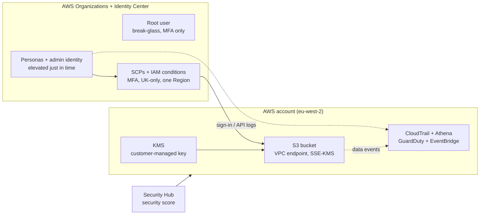

# Cloud IAM Lab (AWS): securing an account where identity is the perimeter

> **Status: in progress.** The AWS counterpart of the Azure Cloud IAM Lab, built
> stage for stage to show the same controls across two clouds. Plan and six phase
> guides are in [docs/](docs/README.md); phase results land here as each is
> completed.

## The business problem

Banks run large estates on AWS, and in the cloud the perimeter is identity, not
the network. Most cloud incidents start with a credential: it is sprayed,
phished, or found over-privileged, and from there an attacker reaches data or
takes control of the account.

This project asks: **if an identity were compromised in an AWS account, would the
controls hold, and would I see it happen?**

## What this lab shows

- **Identity and access:** an account with no standing privilege, administrative
  access elevated just in time, access through IAM Identity Center only, MFA
  enforced, and service control policies plus IAM conditions constraining every
  principal.
- **Data protection:** an S3 bucket reachable only by an IAM principal over a VPC
  endpoint, encrypted with a KMS customer-managed key, with a data-classification
  model.
- **Visibility:** CloudTrail centralised and queried with Athena, GuardDuty added
  for managed detections, events routed with EventBridge, and a documented
  telemetry coverage table.
- **Detection engineering:** five cloud attack techniques validated against test
  identities, each mapped to MITRE ATT&CK, with an Athena detection and a portable
  Sigma version, scored honestly.
- **Governance:** Security Hub score measured before and after, an access review
  using IAM Access Analyzer, and risk communication framed against UK operational
  resilience (PRA/FCA).

## Architecture



See the full environment diagram and rationale in the
[Build 2 on AWS plan](docs/README.md).

## Results

Phase results are published here as each phase completes.

| Phase | Focus | Status |
| --- | --- | --- |
| 1 | Identity and access model (Identity Center, JIT, SCP) | Planned |
| 2 | Data protection (locked S3, KMS CMK, VPC endpoint) | Planned |
| 3 | Visibility (CloudTrail, Athena, GuardDuty) | Planned |
| 4 | Simulate and detect (five techniques, Athena + Sigma) | Planned |
| 5 | Posture and access review (Security Hub before/after) | Planned |
| 6 | Report (incident report, IAM model, business summary) | Planned |

## Repository layout

```
cloud-iam-lab-aws/
├─ docs/           the plan and the six phase guides
├─ iac/terraform/  the environment as code (S3, KMS, VPC endpoint)
├─ detections/
│  ├─ aws/         Athena SQL and EventBridge patterns
│  └─ sigma/       portable versions of each detection
├─ config/         permission sets and SCPs exported as JSON
├─ scripts/        repeatable, benign validation scripts
├─ evidence/       per-phase evidence, alert records, coverage matrix
├─ report/         incident report, IAM model, business summary
└─ lab-notes.md    what broke and how I fixed it
```

## Scope and safety

Everything runs in an AWS account I own, using test identities and synthetic data
only, in the London Region (`eu-west-2`). The detection validation runs harmless
actions against my own test identities to confirm each detection fires. No real
credentials, personal data, or production systems are involved. Cost is held with
a USD 10 budget, one Region, no EC2, and the paid services (GuardDuty, Security
Hub, Config) enabled only for the detection and posture window.

## About me

Built by **Amit Kiran Deb**, MSc graduate (results November 2026) with a
background in OT security (IEC 62443, Purdue model), aiming at cyber security and
technology risk roles in financial services.
[GitHub](https://github.com/Amitdeb00731) · [LinkedIn](https://www.linkedin.com/in/amit-deb-038b642b5/)
